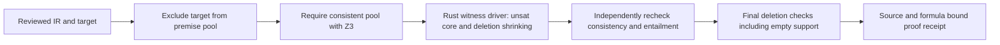
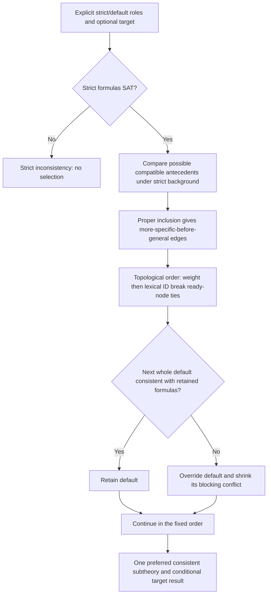
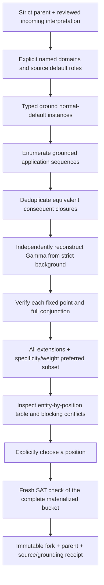

# WMT paper sidecar SDK

The public synthetic example groups symbols, definitions and uses, then connects an explicitly reviewed draft to a checked bucket.

`@wmt/paper-sdk@0.1.0-experimental.5` is a runnable SDK and loopback HTTP API for
paper submissions, versioned personal/RFC buckets, and computational evidence.
The browser consumer is [`../papers.html`](../papers.html). The existing claim,
entity-equality and veri7vn mass workbenches remain available.

This is an **experimental unsigned package**, not a published npm release or a
completed Castalia Gate 0 release. Castalia remains responsible for identity,
registration, peer review, repository acceptance and journal publication. The
SDK produces attributed evidence, not any of those decisions.

## Definition review and retained candidates (.5)

The public [synthetic definition example](../definitions.html) groups repeated
introductions and equations into a single symbol defined in the paper, with
source references, notation forms and statement uses. Its PDF is generated from
an explicitly authored software fixture; no private paper is bundled.

Merge duplicate entries, separate a mistaken link, select a defining passage,
and correct definition/introduction/application/reference roles. Original text,
locators, scopes and extraction IDs remain immutable. Formatting/case variants
of natural names can share an entry; single-letter case, mathematical alphabets
and local declarations in different named results remain distinct. Linking two
forms does not prove they have equivalent types or meanings.

`wmt.definition-review/1` is separate from strict formalization. Validation
reconstructs exact occurrences, checks their editable partition and checksum,
and rejects changed source metadata, duplicate assignments and invalid primary
definitions. SDK exports include `buildDefinitionReview`,
`validateDefinitionReview`, `definitionConcepts`, `mergeDefinitionConcepts`,
`updateDefinitionConcept`, `separateDefinitionOccurrences`,
`moveDefinitionOccurrence`, and `restoreDefinitionOrganization`.

**Principles & candidates** retains ambiguous ideas while they are reworked.
Keep for formalization, wording reviewed, and reversible set-aside are review
states, not proof or bucket-admission verdicts. Existing candidate feedback
formats remain compatible. Browser feedback exports add optional
`definitionReview` and `formalDrafts`, bound to the exact source/extraction;
older exports still load. Draft IR has a live mathematical preview. Invalid
code cannot replace a valid saved draft. Opaque declarations assert nothing.

The browser adapter `papers/reviewed-draft.mjs` connects an authored formula to
the existing SDK proposal/review/bucket API. It qualifies custom names by paper
and draft revision, maps every formula to the chosen exact source passage, and
requires a separate local review. Editing code invalidates that review. A fresh
full-conjunction SAT check can append to a sandbox bucket; a conflicting bucket
is unchanged. All other candidates remain outside that single-passage review.
The example relation remains primitive: a checked definition is not a measured
fact or an authenticated author signature. Exported receipts and sidecars keep
those boundaries explicit.

## The central operation: a person's bucket

A bucket has a stable ID, owner, scope (`personal` or `rfc`), exact version,
content digest, parent reference, and typed WMT claims. Personal buckets and
RFC-scoped buckets are always separate. An RFC bucket additionally names its
exact RFC revision. Claim entrenchment weights are retained.

Submitting a paper to a bucket requires an explicit review of the selected
source-to-formula mappings and the bucket's exact pre-run version **and digest**.
The SDK merges that reviewed subset with the bucket and runs the existing
Rust/Wasm WMT MARCO lattice against real Z3:

- **Full conjunction SAT:** append in one attributed operation, without requiring
  MARCO enumeration. The only maximal position of a consistent full set is the
  full set, so this position can be returned directly.
- **Full conjunction UNSAT:** return a conflict and leave the bucket unchanged.
  Optional MARCO enumeration explains minimal conflicts and coherent repairs.
  Its budget can run out without erasing the independently known UNSAT verdict.
  Pass `enumeratePositions:false` to skip those diagnostics.
- **Consistency UNKNOWN, error, timeout, or cancellation:** never append.
- **Already present and SAT:** return unchanged without another bucket version.

`receipt.consistency` is the direct, digest-bound full-conjunction verdict.
`receipt.analysis` retains the existing repair/enumeration shape. A known
conflict with incomplete diagnostics authorizes no repair fork. Old clients
without the new consistency method retain the former guarded analysis path.

Versions are compared again **after** solving. Concurrent writes cannot
overwrite one another. An idempotency key replays the exact original result;
reusing it with different input fails. Reusing a claim ID with different content
requires an explicit fork or new ID; bucket append does not silently revise it.

Adopting a solver-verified maximal position creates a **new bucket fork**, linked
to the exact parent version and computation receipt. It does not retract claims
from the original person's bucket. Comparing two buckets shows added, missing
and changed claims. Global minimum-weight repairs are chosen among the complete
lattice's correction sets, without the old single-conflict powerset driver.

## Run the browser consumer

From the repository root:

```sh
python3 -m http.server 8799 --directory site
# Open http://127.0.0.1:8799/papers.html
```

1. Load the two demo buckets. The personal bucket says “All birds are fliers.”
   The RFC bucket is empty.
2. Load the actual demo PDF or upload a text-layer PDF.
3. Parse candidates. Read each quoted source beside WMT's deterministic English
   rendering, select the mappings you accept, and confirm them.
4. Attach an entailment artifact and explicitly run the checker, or attach an
   author-provided proof sidecar.
5. Check the personal bucket: the demo yields two irreducible conflicts and four
   coherent positions, with no mutation. Adopt a position as a new fork if desired.
6. Check the separate RFC bucket: the four reviewed demo formulas append as v2.
7. Download the paper sidecar or the entire bucket workspace.

The SDK has no implicit storage. The browser UI holds this session in memory
until explicit download. Workspace restore rechecks bucket heads and re-extracts
the PDF, clears paper-review/proof verdicts, and requires fresh confirmation.
Historical receipts are retained but cannot authorize a new fork; re-run first.
Restore rejects digest changes and attempts to overwrite immutable future
versions. Existing `wmt.tree.v2` and kernel/entity-lab storage are untouched.

## Use from Node / a journal host

Node 20.19+ is required. Install the repository package locally (or the built
tarball); no Isabelle, OCaml or native Z3 installation is needed:

```sh
npm ci --prefix site/sdk
npm install ./site/sdk
```

```js
import {readFile} from 'node:fs/promises';
import {
  createNodeClient, BucketRepository, createSubmission,
  formalizeSubmission, reviewSubmission
} from '@wmt/paper-sdk/node';

const client = createNodeClient();
const buckets = new BucketRepository(client);
const bucket = await buckets.create({
  id: 'person:alice:model', name: 'Alice’s model', owner: 'person:alice'
});
let paper = await createSubmission({
  bytes: await readFile('./paper.pdf'), fileName: 'paper.pdf',
  title: 'My paper', authors: ['Alice']
}, client);
paper = await formalizeSubmission(paper);

// Render paper.proposal.ir through client.request('render', {ir: ...}).
// Your application displays source quotes and renders for a person's review.
// confirmedSourceClaimIds comes from that explicit review, not from the model.
paper = await reviewSubmission(paper, {
  actorId: 'person:alice', sourceClaimIds: confirmedSourceClaimIds
});
const {bucket: next, receipt} = await buckets.submit(bucket.id, {
  actorId: 'person:alice', submission: paper,
  expectedVersion: bucket.version, expectedDigest: bucket.digest,
  idempotencyKey: 'submission-operation-001'
});
```

`BucketRepository` is an in-memory reference implementation with immutable
snapshots and compare-and-swap writes. A host owns durable storage and its
transaction boundary. `export()` / `restore()` support explicit persistence;
restoring into a fresh repository rechecks heads before committing anything.
The standalone `submitToBucket` returns a proposed next snapshot plus receipt
for hosts with their own database/CAS implementation. The application must
commit only if the authoritative current version still matches `before`.

## PDF extraction is a separate stage

PDF.js 5.6.205 extracts the actual PDF text layer, page by page, in a bounded
worker. The source PDF bytes and SHA-256, page text/hash, UTF-16 character span
and exact quote travel with the submission. Text order is PDF text-layer order,
not a guarantee of multi-column reading order. Source bytes are included in
downloaded sidecars; no remote document is fetched. A paper sidecar includes only
its related bucket checks, affected snapshots and their ancestry; exporting the
whole workspace is a separate explicit action.

The bundled `wmt.pdf-text-sentences/1` selector finds heuristic sentence
candidates. Its result is always `candidate_partial`. It is not a complete
scientific claim census. Equations, references, tables, image-only pages and
layout can require better extraction or human review. A PDF without text yields
`ocr_required` and no invented claims. No OCR engine is bundled.

A host can install a scientific/model selector without changing the reasoning
engine. It must select **actual in-page source spans**. The SDK mints stable
claim IDs, quotes and locators itself and rejects invented/ambiguous quotes:

```js
import {createModelClaimSelector, createModelFormalizer} from '@wmt/paper-sdk';
import {createSidecarServer} from '@wmt/paper-sdk/server';

const select = createModelClaimSelector({
  completeJSON: sourceAwareModelCall // explicit host callback, not a bundled service
});
const parse = createModelFormalizer({
  id: 'my-provider/model-revision-and-prompt-v1',
  completeJSON: typedFormalizationModelCall
});
const {server} = createSidecarServer({
  claimExtractor: {id: 'my-scientific-extractor/1', select},
  formalizers: new Map([['my-provider/model-revision-and-prompt-v1', parse]])
});
server.listen(8801, '127.0.0.1');
```

Model calls are not supplied, invoked by default, or claimed as live-tested.
The host explicitly supplies any provider, credentials, disclosure policy,
timeouts and cancellation for its callbacks. The default browser/API performs
no remote model call. Callback adapters remain outside the bounded reasoning
worker; a host must isolate/budget any additional checker or model it installs.

## Parsing into WMT's language

The SDK uses WMT's existing many-sorted first-order JSON IR, not a new proof
language and not raw SMT-LIB. The `wmt.strict-many-sorted-fol/1` profile supports
Bool/Int/Real, uninterpreted sorts/functions, arithmetic, quantifiers and logical
connectives. IR is closed and type-checked before entering the core. Symbols
must be declared, Real literals are restricted to exact numerals/rationals,
variables must be bound, and inactive/default claims cannot hide in a strict
submission. This avoids feeding arbitrary solver text into the old Real field.

The executable built-in parser supports:

```text
All penguins are birds.
Every penguin is a bird.
No penguins are fliers.
Tweety is a penguin.
Tweety is not a flier.
```

Its vocabulary explicitly maps class phrases and entity names to logical
symbols. It does not guess plurals, synonyms or identity mappings. Unsupported
sentences remain visible with reasons; they do not become unrelated Boolean
atoms or false claims. The browser exposes vocabulary editing, a source-aware
model prompt, and authored-proposal JSON input.

For general prose, use a host-registered formalizer or submit authored
`{ir, mappings, parserId}`. Every formula must map to an existing source claim.
`createModelFormalizer` requires an explicit adapter/model revision, validates
structured output, preserves source claim IDs and the original quote, and can
return explicit unsupported status. A model's output is always a **draft**;
neither an extraction model nor a formalizer can confirm review or append.

The prior entity-equality experiment remains compatible: its concrete,
snapshot-guarded IR can be represented in an authored proposal with explicit
source mappings. Its OCaml receipt may travel as a custom proof artifact. A
host must install a matching verifier to re-execute it; importing JSON does
not inherit the veri7vn theorem or make an old computation freshly checked.
Namespace reusable ground symbols/claim IDs explicitly when composing multiple
observations; conflicting revisions are rejected rather than silently aliased.

## Computational proof sidecars

Submissions accept `wmt.computational-proof/1` artifacts containing:

- kind and stable artifact ID;
- exact PDF, proposal, reviewed-IR and target-claim bindings (or `null` if unbound);
- checker-specific evidence; and
- original named assets as base64 with SHA-256 checksums.

Author-supplied `status: checked` fields are rejected. Checksummed attachment is
not proof checking. Lean/Isabelle/custom sources are retained but remain
`not_checked` unless an installed host verifier handles their exact kind.
Submitted commands or source files are never automatically executed.

The built-in `smt-entailment` checker runs real Z3 against the **same WMT
formulas**: the declared premises must be consistent, and premises plus the
negation of the exact target must be unsatisfiable. The target cannot be one
of its own premises. This checks a concrete derivation; it does not establish
natural-language fidelity or empirical premises.

```js
import {makeEntailmentProof, verifySubmissionProofs} from '@wmt/paper-sdk';
paper.proofs = [await makeEntailmentProof(paper, {
  id: 'proof:bird', targetClaimId, premiseClaimIds
})];
paper = await verifySubmissionProofs(paper, client);
// Inspect paper.proofReceipts; matching files/names alone never yield checked.
```

Hosts can register `verifiers: Map<kind, {id, revision, verify}>`. A custom result
must name an installed checker revision and bind the exact input IR digest.
The host owns the checker's isolation, execution and guarantee. A replacement
comparison/checker gets no proof inherited from a reference implementation.
No `LeanReceipt` is fabricated by this SDK.

## HTTP API

```sh
npm ci --prefix site/sdk
npm start --prefix site/sdk -- --port 8801
# http://127.0.0.1:8801/v1/openapi.json
```

The CLI binds loopback only. It accepts bounded JSON, rejects unknown fields and
cross-origin requests, and stores data in memory. Actor IDs are **self-attributed**,
not authenticated. This is a local sidecar reference API; do not expose it as an
authenticated journal service. A journal host supplies identity/authorization,
durability, operational limits and publication workflow separately.

| Operation | Purpose |
| --- | --- |
| `GET /v1/capabilities` | Exact runtime profile, installed adapters and unsigned-release boundary |
| `POST /v1/submissions` | PDF `{fileName, base64}`, title/authors, optional RFC/publication refs and proof artifacts |
| `GET /v1/submissions/:id` | Current submission plus its exact revision counter |
| `POST /v1/submissions/:id/formalizations` | Controlled/configured parser, or authored IR and mappings |
| `POST /v1/submissions/:id/review` | Explicit reviewer ID and accepted source claim IDs |
| `POST /v1/submissions/:id/proofs` | Replace attached proof artifacts, clearing current proof receipts |
| `POST /v1/submissions/:id/proofs/check` | Run installed verifiers |
| `GET /v1/submissions/:id/sidecar` | Complete local, not-published paper/proof/bucket-evidence bundle |
| `GET /v1/buckets` | Named bucket heads |
| `POST /v1/buckets` | Create a named personal or RFC-scoped bucket |
| `GET /v1/buckets/:id?version=N` | Exact immutable snapshot (current if version omitted) |
| `POST /v1/buckets/:id/submissions` | Atomic conditional append or conflict/stop receipt |
| `POST /v1/buckets/:id/forks` | Adopt an exact computed coherent position as a new bucket |
| `GET /v1/receipts/:id` | Exact insertion/conflict/stop receipt |

Submission updates require `expectedRevision`. Bucket submission requires
`expectedVersion`, `expectedDigest`, `actorId`, `submissionId`,
`submissionRevision` and `idempotencyKey`. Stale input returns HTTP 409.
No endpoint publishes to Castalia, creates a PR, contacts authors, or grants
governance/reviewer authority. See [`openapi.json`](openapi.json) for shapes.

## Runtime, budgets and provenance

Each reasoning/PDF request gets a fresh worker, terminated on completion, error,
cancellation or deadline, including its child PDF/Z3 workers. Defaults are
30 seconds wall time, 1.5 seconds per solver script and 3000 driver steps, with
hard host ceilings. The SDK profile limits a combined IR to 64 claims, 24 levels
of formula depth and 10,000 AST nodes. PDF limits are 12 MB, 200 pages and one
million extracted characters; candidate count is 256. These are explicit SDK
budgets, not new limits on the original WMT workbench.

The adapter stops on every solver `unknown` or malformed reply, even during
lattice growth/shrink. It never lets the old driver interpret an error as
unsatisfiable. Partial/capped enumeration is discarded from append/fork
eligibility. A hard wall-clock limit also covers solver initialization.

`runtime/manifest.json` pins the unchanged WMT binary/bindings, Z3 wasm, SDK
adapters, PDF.js and standard-font assets by checksum. Node checks the engine
and solver binary hashes before analysis. The build tests check the complete
manifest; it is a build record, not a signed attestation of an isolated browser
deployment. Rebuild/synchronize after source/dependency changes:

```sh
npm ci --prefix site/sdk
node tools/sync-paper-sdk.mjs
```

Bucket receipts bind owner/scope, exact before/after snapshots, source PDF,
proposal/review/input digests, engine/solver/profile/budgets, complete result and
operation identity. Proof receipts bind exact checker inputs and target claims.
There are no inherited proofs from the mass kernel and no claim that arbitrary
OCaml/Lean/model output has been verified without its checker running.

## Castalia compatibility and remaining release work

The adapters `toCastaliaClaimSet` and `toCastaliaAnalysis` validate against the
closed publication schemas captured from Castalia Web commit
`b17705041334b49055e7a05d5dd9f36513657833`. Their exact source hashes live under
`test/castalia/source.json`. The caller allocates canonical `PCS`, `CLM`, `PAS`,
`FMT` and `PMS` identities; the SDK does not mint accepted repository artifacts.
Extraction never becomes `reviewed_complete`, and SMT entailment does not become
a Lean receipt or a whole-paper proof. Exact byte/source locators remain in the
full WMT sidecar alongside the narrower Castalia projection.

The existing Castalia contracts are not modified. `WmtEvidenceV1` and
`RfcBucketV1` are architecture requirements there, without implemented canonical
schemas in the inspected snapshot; this SDK uses its own versioned receipts
rather than inventing Castalia contract conformance.

A signed, reproducible, isolated browser-engine release is still a Castalia
Gate 0 prerequisite. Publication hosting, repository validation/acceptance,
authentication, production durable storage, OCR, live model configuration,
Lean/Isabelle project verification, and Universal Weave history integration are
not completed by this experimental SDK. The versioned bucket graph is ready
for a history/persistence adapter without coupling claim reasoning to it.

## Verification and package check

```sh
npm ci --prefix site/sdk
npm test --prefix site/sdk
npm run test:types --prefix site/sdk
node --test e2e/kernel-model.test.mjs e2e/entity-model.test.mjs
cd e2e && npm ci
BASE=http://127.0.0.1:8799/ PW_CHANNEL=chrome node papers.mjs
```

Tests execute real PDF.js, WMT/Wasm and Z3. They cover source locators, controlled
and injected-model seams, invalid typed IR, full coherent positions, conditional
append, unchanged conflicts, CAS races, idempotency, exact nonvacuous entailment,
unchecked Lean assets, digest mismatch, timeout/cancellation/caps, transactional
restore, Castalia schema projections and OpenAPI request contracts. A TypeScript
consumer checks the SDK exports. Browser tests upload an actual PDF, confirm
four mappings, check evidence, fork a coherent alternative, append to a separate
RFC bucket, export/reload, recheck, and preserve the original app's stores.
Live third-party model calls and external proof checkers are not CI-verified.

## Structured proof candidates and extraction feedback

The opt-in `wmt.proof-candidates/1` selector complements the unchanged
`wmt.pdf-text-sentences/1` baseline. It joins wrapped text within a page,
retains labeled results and formula/declaration blocks, and can select a local
`Let ...` span inside a named result. It still extracts a **partial** candidate
set: it does not reconstruct cross-page statements, complete PDF layout,
mathematical expression trees, or lexical scope.

```js
import {
  createSubmission, PROOF_CANDIDATE_POLICY, selectProofSpans,
  buildCandidateReview, updateCandidateFeedback
} from '@wmt/paper-sdk';

const submission = await createSubmission(input, client, {
  claimExtractor: {id: PROOF_CANDIDATE_POLICY, select: selectProofSpans}
});
let candidateReview = await buildCandidateReview(
  submission.document, submission.extraction
);
candidateReview = await updateCandidateFeedback(candidateReview, sourceClaimId, {
  role: 'lemma', scopeType: 'local', scopeLabel: 'Only in this proof',
  disposition: 'needs_change', note: 'Retain the surrounding assumption.'
});
```

`wmt.candidate-review/1` separates a passage's suggested role from its source
text, epistemic grade, formalization and proof status. Roles include schema,
definition, notation, axiom, assumption, hypothesis, conjecture, statement,
proposition, lemma, theorem, corollary, proof step, observation, example,
construction, case, goal, algorithm and question. A source label such as
"Theorem" is retained as a label; it is not evidence that a theorem was proved.
Calling a passage an axiom records a proposed assumption, not its truth.

The review binds the exact document hash and extraction digest. It retains
source order, suggested declarations, expression-bound variables, explicit
source references, unresolved references and ambiguity notes. A contained
local declaration retains a parent source candidate. A preceding result label
is only contextual evidence: without an established endpoint its extent remains
unresolved. The definitions index collects source passages wherever they occur;
it does not promote a local or unknown-scope declaration to global scope.

The UI offers review order (definitions, premises, results, proof material),
original paper order, and groups based on labeled results and explicit source
references. These groups are not an inferred or verified proof dependency graph.
Role, scope, interpretation, disposition and note feedback is saved in browser
storage under the exact extraction binding and can be exported/imported as
`wmt.candidate-review-bundle/1`. A changed source or extraction is rejected on
import. Browser feedback is self-attributed and does not confirm source-to-IR
mappings, run proof checkers, or mutate a bucket.

"Birds are normally fliers" remains a candidate statement with alternative
interpretations: a defeasible rule, an explicitly weakened existential rewrite,
a statistical prevalence/expectation statement, or a restriction to normal cases.
No interpretation is selected automatically. A statistical reading needs a
population, measure, time/context and threshold or target expectation. For a
binary property, its expected indicator is its proportion under that measure;
"normally" alone does not choose a population or threshold. Choosing an option
records extraction feedback only; it does not synthesize or accept an axiom.

Compatibility: existing source claim IDs, saved cases, proposals, reviews,
proof receipts and `SourceClaim.kind` remain unchanged. The rich roles live in
this separate review artifact. The opt-in selector projects lemma/corollary/
proposition to legacy `theorem`, schema/notation to `definition`, and assumption
to `axiom` when constructing the old source record. The full distinctions remain
in the candidate review. This allows the pinned closed Castalia publication
schema to remain valid; a Castalia claim-set projection alone does not carry the
richer taxonomy. Export the candidate review alongside the publication sidecar.

The standard workbench and public synthetic walkthrough expose this review
layer. Candidate extraction stays separate from explicitly reviewed formulas
and their proof/bucket scenarios.


## Collective conflicts, discovered witnesses, and explicit defaults (.3)

Open [`../reasoning.html`](../reasoning.html) for three runnable examples.
The computational evidence section of the generic workbench exposes the same
operations as the standalone reasoning examples.

### Whole conflicts and argumentation

`analysis.conflicts` remains the authoritative list of inclusion-minimal
inconsistent groups (MUS). The additive `analysis.conflictSemantics` records
these groups and collective attacks: for each member `c` of a group `G`, the
entire set `G \ {c}` collectively excludes `c`. In particular, `P`, `Q`, and
`¬(P ∧ Q)` produce one three-way conflict, three two-premise collective attacks,
and three coherent pairs. They do **not** produce three binary conflicts.
A singleton inconsistent group produces an empty-premise collective exclusion.
No Dung admissibility, preferred or stable extension equivalence is claimed.

For old readers, `analysis.acceptance.attacks` still contains the legacy pair
co-membership projection. It is deprecated for reasoning and is now explicitly
labelled `attackSemantics: "legacy-co-membership-only"`. Use conflict groups or
collective attacks instead. The other acceptance arrays still describe MSS
membership (every/some/no maximal coherent position). Existing stored receipts
without the new fields remain usable by the paper visualization, which reads
`conflicts` directly. The original workbench now also draws whole groups and
removes its former false binary-Dung equivalence claim. The core binary's legacy
pair projection is unchanged; this release corrects its adapter/display meaning.

### Automatically discover why a conclusion follows

```js
const result = await client.witness(review.ir, {
  targetClaimId: 'conclusion',
  // Optional: otherwise every other reviewed formula is a candidate premise.
  candidatePremiseIds: ['definition', 'assumption', 'lemma']
});
// result.status === 'checked' => result.premiseClaimIds is one minimal support.
const artifact = await makeWitnessProof(paper, {
  id: 'proof:auto', targetClaimId: 'conclusion',
  candidatePremiseIds: ['definition', 'assumption', 'lemma']
});
paper.proofs.push(artifact); // kind: smt-explanation-witness
paper = await verifySubmissionProofs(paper, client);
```

The pipeline is:



1. Validate the strict typed IR and unique premise IDs; reject a target included
   as its own premise. Validate binding to the exact source and reviewed IR.
2. Check the **whole candidate pool** is SAT. An inconsistent pool fails rather
   than proving anything by explosion. Narrow it to a chosen coherent position
   when needed. This operation does not search all consistent subsets of an
   inconsistent pool.
3. Run the unchanged Rust `witness_begin/next/feed/result` driver against Z3.
   Every reply must be SAT/UNSAT without unexpected errors; UNKNOWN stops.
4. Verify the returned IDs belong to the pool. Independently recheck that its
   premises are SAT and their conjunction with the negated target is UNSAT.
5. Delete each retained premise in turn and test again, dropping it if the
   target remains entailed. This also handles a tautology's empty witness, where
   the legacy driver can stop early on a singleton. Record the final necessity
   checks. Monotonicity makes this deletion check inclusion-minimal.
6. Bind the full IR digest, target formula digest, ordered candidate pool,
   request digest, runtime, limits and discovered support. A checked artifact
   can be attached to the usual sidecar and rechecked through the existing API.

This finds **one inclusion-minimal** support. It is not all supports, the
smallest support, a proof of extraction fidelity, or a derivation of every cited
lemma. Any candidate premise, including a lemma, is an assumption for this
particular check. The UI lets you inspect and narrow that pool.

### Explicit defaults and logical specificity

```js
const result = await client.defeasible(review.ir, {
  defaultClaimIds: ['birds_fly', 'penguins_do_not_fly'],
  targetClaimId: 'tweety_flies', // optional, excluded from both strict/default inputs
  policy: 'wmt.strict-specificity-greedy/1'
});
const receipt = await analyzeSubmissionDefaults(paper, {
  defaultClaimIds: ['birds_fly', 'penguins_do_not_fly'],
  targetClaimId: 'tweety_flies'
}, client);
```

All unmarked, non-target formulas are **strict**. Defaults are entire formulas
that may be omitted when inconsistent. The strict IR format still rejects
`defeasible:true`; default roles live in this separate explicit request, so a
saved strict bucket cannot silently change its logic.



The exact policy is:

- Start by checking the strict background is consistent. Strict inconsistency
  returns `strict_inconsistent`; defaults cannot repair it.
- A specificity candidate is a ground implication or an implication under one
  or more outer universal binders. Compare antecedents only when the ordered
  binder-sort signatures match; alpha-rename binders with fresh variables.
  Arbitrary typed antecedent formulas, including conjunctions, are allowed.
- Require each antecedent is possible under the strict background (test
  satisfiability of its existential closure). Impossible antecedents do not
  gain priority through vacuous inclusion. Other formula shapes stay available
  as defaults but receive `priority_only` eligibility.
- `A` is more specific than `B` exactly when the strict background entails
  `forall vars. A => B` and does **not** entail its reverse. Equivalent
  antecedents and different binder sorts produce no edge. This is an explicit
  logical-inclusion approximation to specificity, not every Poole criterion.
- Topologically order the strict-inclusion graph. Among ready nodes, prefer
  higher entrenchment weight, then ascending ASCII claim ID. More-specific
  edges therefore take precedence over general defaults' higher weights.
- Greedily retain each entire default when consistent with the retained
  formulas; otherwise override it. Shrink a rejected default plus the retained
  background into an inclusion-minimal blocking conflict. These groups explain
  **that rejection**, not a pairwise attack or unique cause.
- If a target is supplied, check it and its negation against the selected
  consistent subtheory. Report `supported_in_selected_subtheory`,
  `refuted_in_selected_subtheory`, or `undetermined`. None is a `checked`
  assumption-free proof receipt. The target never supports its own query.

This is **one deterministic preferred consistent subtheory**, with a recorded
linear priority policy. It does not enumerate all Brewka preferred subtheories,
compute skeptical/credulous default entailment over all extensions, implement
arbitrary Reiter default rules, inherit the legacy core's specificity ranking,
or automatically ground a universal default separately for each individual.
Consequently an exception can override an entire universal rule. Per-individual
exceptions and richer defeasible consequence relations require a future profile.
It also does not establish AGM postulates. The existing Rust compiler/Z3 runtime
is reused; the more careful specificity ordering is a new JS adapter policy,
not an assertion that the legacy Rust defaults algorithm was repaired.

Normality remains an interpretation decision: choosing this defaults mode does
not turn “normally” into an existential, majority, probability, mean or modal
operator. Candidate-extraction feedback remains separate from formalization.

### API, limits and storage boundaries

`POST /v1/submissions/{submissionId}/reasoning/defaults` accepts
`{ expectedRevision, request: { defaultClaimIds, targetClaimId?, policy? }, limits? }`
and returns `{ revision, receipt }`. The separate `wmt.paper-reasoning/1` receipt
binds document, proposal, IR and exact reasoning request; this route does not
increment the submission revision or persist its result into the paper sidecar.
Download/store that receipt separately. Witness artifacts use the existing
`/proofs`, `/proofs/check` and `/sidecar` routes and are included in the sidecar.

Both new worker operations use the same fresh-worker cancellation and wall
budget as strict analysis, plus a shared per-operation solver-call count and
per-query Z3 timeout. UNKNOWN, solver errors, invalid inputs, cancellation,
timeout or exhausted budgets never produce a complete preferred set or a checked
witness. Intermediate default choices are not returned as final results.
The existing strict limit remains 64 claims; defaults and support search do not
lift it. They also do not remove MARCO's runtime enumeration cap.

Defaults receipts do **not** append to strict buckets or override their claims.
A conditional result cannot ratify a paper or change an owner's accepted model.
Old strict submissions, receipt shapes and Castalia projections continue to load;
new optional conflict metadata, proof kind and separate defaults endpoint are
additive. Review the new policy explicitly before using it for a paper.


## Every named-entity default extension and verified bucket forks (.4)

Open [`../reasoning.html?example=extensions`](../reasoning.html?example=extensions).
The combined example has Tweety, Robin and Nixon. It produces **four** normal
extensions and **two** preferred extensions. Tweety's specific penguin exception
wins in both preferred positions while Robin still flies. Nixon's equal-priority
Quaker/Republican defaults remain alternatives. A comparison table shows every
grounded default's Applied / Blocked / Not triggered status in each position.
Every position can be inspected and explicitly forked into a new bucket.

### New semantics: finite named normal defaults

`wmt.named-normal-extensions/1` is separate from the retained whole-rule greedy
profile. For each default claim, remove its outer universal binders and
instantiate them over the chosen declared zero-argument constants of matching
sorts. An implication `A => B` becomes the **normal default** `A : B / B`.
A non-implication becomes `True : formula / formula`. The implication is not
asserted as a strict material rule: no contrapositive or antecedent assumption
is obtained by choosing a default. Inner bound quantifiers stay bound.

For example, `forall x. Bird(x) => Fly(x)` generates separate defaults
`Bird(robin) : Fly(robin) / Fly(robin)` and
`Bird(tweety) : Fly(tweety) / Fly(tweety)`. Blocking the latter does not block
Robin's instance. The exact original rule, substitutions and ground primitive
formulas are recorded in `grounding.instances`. Empty or missing domains for an
outer quantified variable stop with `missing_ground_domain` rather than
silently claiming completeness. Names are not implicitly distinct; equality or
inequality constraints stay in the strict IR and are handled by Z3.

This profile enumerates all coherent **normal-default** extensions of that
finite grounding, using the deductive closure of the shared strict background.
It does not claim to ground unnamed first-order individuals or enumerate an
infinite domain. Explicit entity selections are not closed-domain axioms.
Normal defaults have their justification equal to their conclusion; arbitrary
separate justifications are not part of this profile. The fixed-point notion is
Reiter's normal-default operator, as stated in Definition 3 of
[Rychlik's primary paper on default semantics](https://cdn.aaai.org/AAAI/1991/AAAI91-058.pdf),
with [Reiter's original paper](https://www.sciencedirect.com/science/article/pii/0004370280900144)
providing the origin of default logic. The preference filter below is this SDK's
explicit additional policy; it is not claimed to coincide with every prioritized
or Brewka default semantics.



### Enumerator and verifiability

1. Validate the source IR, default IDs, target exclusion, typed named domains and
   budgets. Existing parent-bucket assumptions are always strict. A source rule
   already in the parent cannot be silently reclassified as a default.
2. Check the strict background is SAT. On UNSAT, return `strict_inconsistent`
   with no coherent positions; normal defaults do not repair strict assumptions.
3. Starting from that background, find defaults whose prerequisites are
   entailed and whose conclusions are consistent with the current theory.
   Branch on each eligible conclusion and continue until no new consistent,
   triggered conclusion can be added. There is no branch that simply assumes an
   unsupported prerequisite. Therefore a cycle `P:P/P` has no self-generated P.
4. Memoize theories by their entailed subset of the finite consequent basis.
   Since every theory shares W and is generated by that basis, this signature
   merges logically equivalent extensions rather than counting different rule
   application orders. Strictly entailed prerequisites and conclusions are safe
   shared checks. If all possible consequents are jointly consistent, batch
   applicable rules to compute the unique monotonic closure.
5. At every terminal candidate E, independently reconstruct `Gamma(E)` from W,
   fixing justification consistency to E and iterating its triggered unblocked
   normal defaults. Verify that Gamma and E entail the same consequent basis,
   and that the result is SAT. This checks the fixed point rather than relying
   solely on a search terminal or a maximal consistent subset. Circular
   support and incomplete closure fail this check.
6. Classify each instance: **Applied** when its prerequisite and conclusion
   follow; **Blocked** when its prerequisite follows and its conclusion is
   refuted; **Not triggered** when its prerequisite does not follow. A strict
   reason can already entail a conclusion even when that particular default
   did not trigger. Materialized positions include all entailed ground
   consequences, not unsupported universal rules.
7. Deletion-shrink each blocked conclusion together with the final position
   into a minimal blocking conflict group. These are whole conflicts, not
   binary attacks. Store a generating derivation and the typed ground basis.
8. Once the search is exhausted, summarize consequence membership and the
   target's supported/refuted/undetermined status across **all** extensions and
   separately across preferred ones. Skeptical support requires support in
   every position of the named set; credulous support requires at least one.

The enumerator is exhaustive when `complete:true, stopReason:"completed"`.
A solver UNKNOWN/error, cancellation, missing domain, or exhausted solver-call,
state or wall budget returns no adoptable extensions. It does not label a
partial prefix complete. The existing 64-formula SDK profile remains: strict
formulas plus grounded default instances must fit it. The configured budgets
still bound exponential branching. These limits are reported explicitly.

An independent test oracle exhausts all candidate consequent subsets and
computes their fixed points separately. It agrees with the search for support
chains, self-support cycles, delayed conflicts, and a three-way conflict where
all pairs are consistent. Native Node and real Chrome run the same adapter and
unchanged Rust compiler / Z3 4.16 solver assets.

### Preference among extensions

Keep **all** normal extensions visible, including lower-priority alternatives.
Compute proper strict-background logical specificity between compatible source
antecedents as before. Form successive specificity layers: more specific sources
come first. Within a layer, higher weights precede lower weights. Each resulting
stratum contains all grounded instances of its tied source rules.

Extension E dominates F only when all earlier strata have identical applied
instance sets, and at the first differing stratum E's applied set is a **proper
superset** of F's. Incomparable tied sets remain preferred alternatives. IDs
stabilize display order; they never break an actual semantic tie. This is set
inclusion preference, not majority voting or maximum cardinality. The exact
strata and preferred extension IDs are part of the receipt. This policy is
explicitly versioned rather than asserting equivalence with every Poole,
Brewka, Reiter-priority or AGM formalism.

### SDK and bucket APIs

```js
const all = await client.extensions(review.ir, {
  defaultClaimIds: ['birds', 'penguins', 'quakers', 'republicans'],
  targetClaimId: 'target',
  entities: [
    { name: 'tweety', sort: 'Entity' },
    { name: 'robin', sort: 'Entity' },
    { name: 'nixon', sort: 'Entity' }
  ]
});
// all.extensions: every verified extension; .preferred is a separate filter.

const receipt = await buckets.enumerateDefaults(parent.id, {
  expectedVersion: parent.version, expectedDigest: parent.digest,
  actorId: parent.owner,
  submission: paper, // requires reviewed, exact PDF/formula bindings
  // Alternatively: candidateIR: explicitTypedIR, with no claimed PDF binding.
  request: { defaultClaimIds: ['birds', 'penguins'], targetClaimId: 'query' }
});
const chosen = receipt.result.extensions.find(e => e.preferred);
const fork = await buckets.forkExtension(parent.id, {
  receiptId: receipt.id, extensionId: chosen.id,
  newId: 'model:alternative', name: 'One coherent position',
  actorId: parent.owner,
  expectedVersion: parent.version, expectedDigest: parent.digest
});
```

A bucket's acceptance remains the satisfiability of its **whole conjunction**.
A pairwise-only check would miss the P, Q, ¬(P ∧ Q) conflict. The new
`client.consistency` performs that direct check in one solver call. Strict
admission does not wait for default-extension or repair enumeration. Coherent
subsets do not make an inconsistent full bucket acceptable.

`forkExtension` only accepts a fresh live receipt from this repository, bound
to the exact parent ID/version/digest. It rechecks the selected materialized
IR's digest, preserves every parent assumption, performs a fresh SAT check, and
compares the parent and fork ID again after solving. A stale parent, forged
extension ID, unknown result, cancellation or concurrent change prevents commit.
The original bucket is unchanged. A lower-priority enumerated extension can be
adopted explicitly as an alternative hypothesis; its priority status is retained.

The new fork freezes the chosen ground conclusions as **explicit strict
assumptions** for subsequent bucket checks. Its provenance retains source rules,
entity substitutions, preference policy and extension receipt. Changing facts
requires a fresh enumeration and an explicit new trajectory; this release does
not silently recompute or retract already accepted bucket assumptions.

HTTP endpoints:

- `POST /v1/buckets/{bucketId}/default-extensions`: exact parent version/digest,
  actor, request, limits, and either a reviewed `submissionId` +
  `submissionRevision` or an explicit `candidateIR`.
- `POST /v1/buckets/{bucketId}/extension-forks`: receipt, extension, new bucket
  identity and exact parent reference.
- Existing `/submissions` bucket checks also accept `enumeratePositions:false`
  to skip repair diagnostics. Known UNSAT still rejects; UNKNOWN never appends.

`BucketRepository.export()` includes additive `extensionReceipts`. Restore
validates their digests and preserves them as historical evidence, never fresh
fork authority. Re-enumerate after restoration to authorize a new fork.
Paper sidecars include only extension receipts whose source binding names that
paper, plus its related forks and ancestors. Direct IR examples do not acquire
fake PDF provenance. The standalone example, the synthetic definition example and
the generic workbench offer workspace/receipt exports; example bucket views
also show the newly created default-extension trajectories.

The .3 greedy profile and stored strict records continue to load. New APIs,
workspace/sidecar receipt fields and bucket consistency evidence are additive.
The intended admission change is that a completed direct SAT/UNSAT check stays
authoritative even when optional enumeration is skipped or incomplete.
